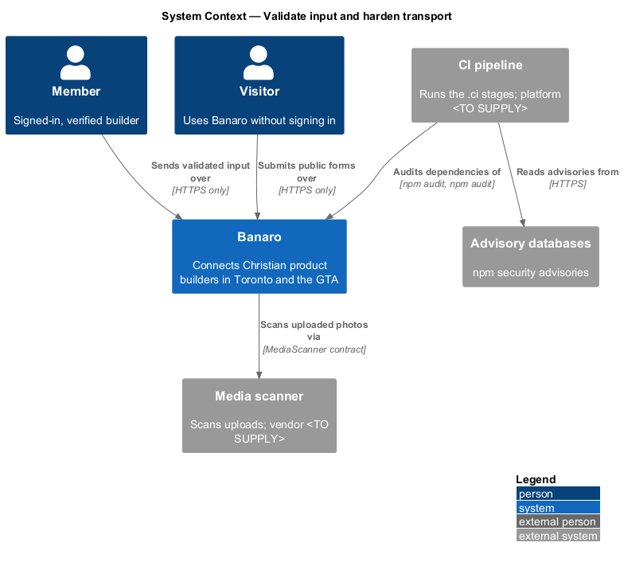
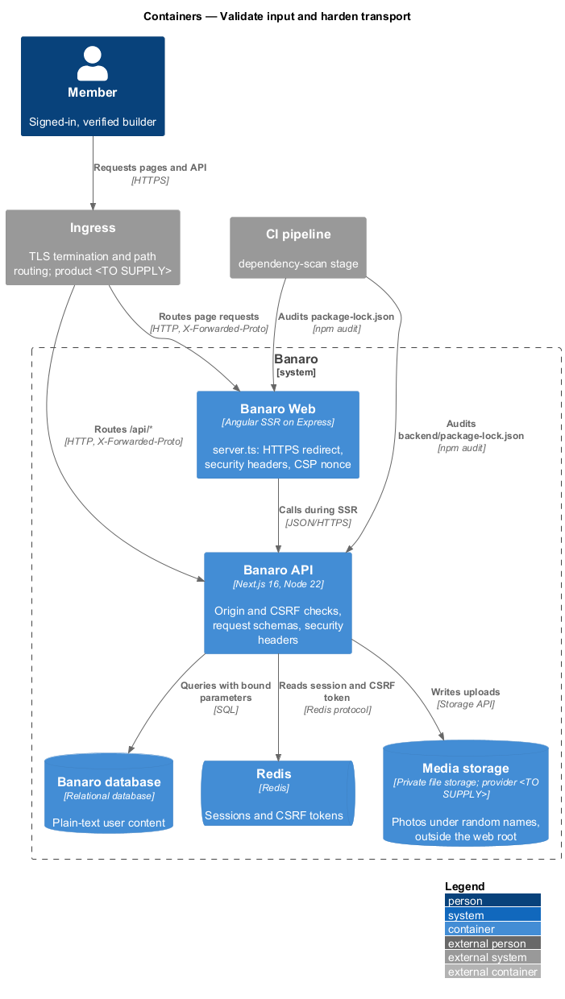
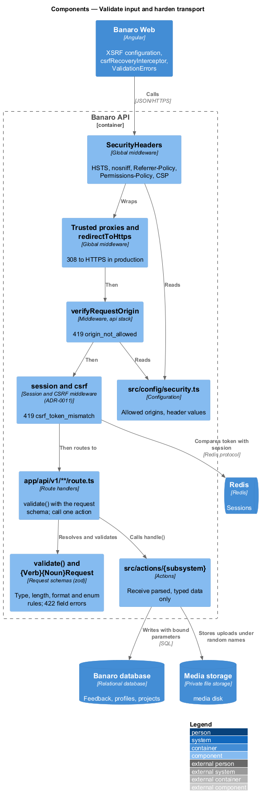
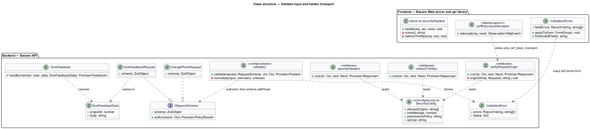
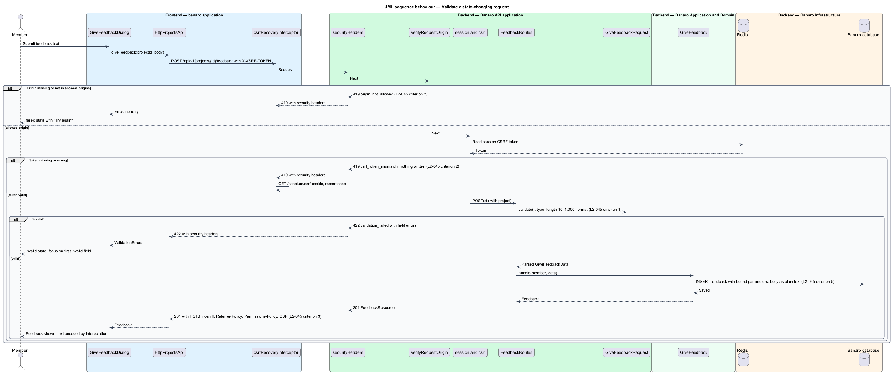
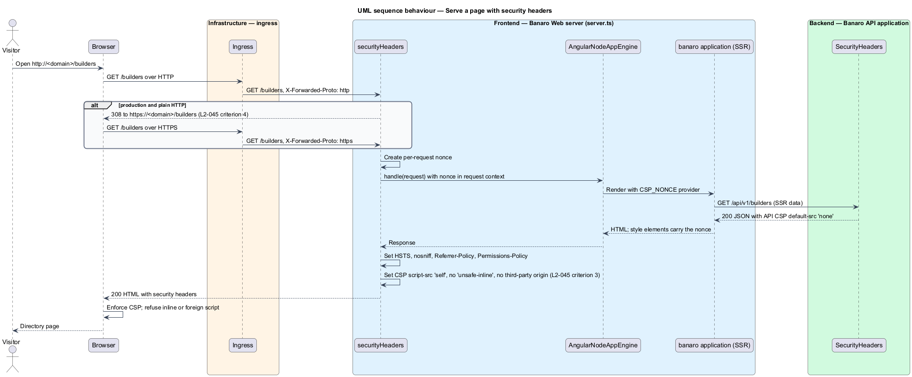
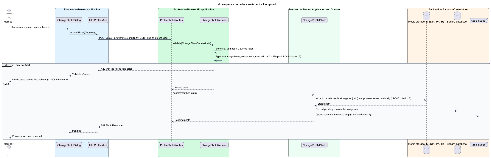
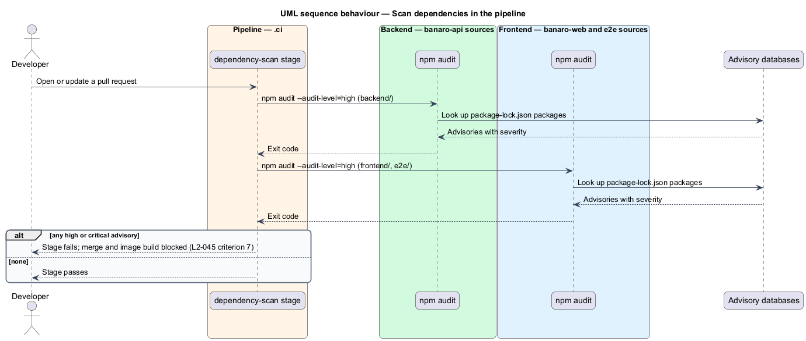

# Validate input and harden transport

## Overview

Every request that reaches Banaro carries input from a browser that Banaro does not control. This
feature is the mechanism that validates all of that input on the server and hardens the traffic and
browser behaviour around it. It belongs to the `security` subsystem. It has no screen of its own; every
slice that accepts input or serves a response runs through it.

Terms used in this design:

- **request schema** — module that pairs a zod schema with an optional `authorize()` check for one endpoint's input; `validate()` runs it before the route handler calls an action
- **field error** — validation message keyed by the name of the input field that failed
- **CSRF token** — per-session secret that the browser echoes in the `X-XSRF-TOKEN` header to prove a request came from a Banaro page
- **allowed origin** — scheme, host and port from which Banaro Web pages are served and from which state-changing requests are accepted
- **state-changing request** — request with method `POST`, `PUT`, `PATCH` or `DELETE`
- **security headers** — response headers that restrict how a browser treats the response: `Strict-Transport-Security`, `X-Content-Type-Options`, `Referrer-Policy`, `Permissions-Policy` and `Content-Security-Policy`
- **Content Security Policy (CSP)** — header that lists the sources from which a page may load script, style, images and connections
- **bound parameter** — value passed to the database separately from the SQL text, so it is never parsed as SQL
- **output encoding** — conversion of characters such as `<` and `&` into a form that a browser shows as text

The feature has seven parts, one per acceptance criterion of `L2-045`. Every endpoint validates its
input with a request schema. State-changing requests pass an origin check and a CSRF check. Both Banaro
Web and the Banaro API add the security headers. Plain HTTP is redirected to HTTPS. Queries use bound
parameters, and user text is stored as plain text and encoded on output. Uploads are checked and stored
outside the web root. The pipeline fails on vulnerable dependencies.

## Description

The representative request is a member posting feedback on a project from the `give-feedback`
dialog.

### Backend — validation

- **`validate()`** (`src/http/validation/validate.ts`) — runs a request schema against the request.
  It reads the JSON body, the query string (bracket arrays such as `role[]` are parsed with `qs`) or
  the multipart form, trims strings and converts empty strings to `null`. It calls the schema's
  `authorize(ctx)` first, then `schema.safeParse()`. On failure it throws `ValidationError`, which the
  error boundary renders as 422 with body `{ "message", "code": "validation_failed", "errors":
  { "<field>": ["<message>"] } }` (`L2-045` criterion 1). On success it returns the typed, parsed
  data, from which zod has stripped unknown keys.
- **`{Verb}{Noun}Request`** (`src/http/requests/{subsystem}/`) — one per endpoint, including read
  endpoints with query parameters. The zod schema states type (`z.string()`, `z.number().int()`,
  `z.boolean()`), length (`min`, `max`), format (e-mail, URL, date) and enum membership (`z.enum(...)`
  over the closed vocabularies in `src/enums/`). For example, `GiveFeedbackRequest` requires `body`
  as a string of 10 to 1,000 characters (`L2-016` criterion 1).
- **Route handlers** — every handler that takes input calls `validate()` with its request schema
  before it calls an action, so an action never receives unvalidated input. Handlers never read
  `req.json()` or the query string themselves.
- **Validation messages** — come from the translation catalogue that the `localize-and-format`
  feature (`L2-052`) describes, through a zod error map keyed by rule. The frontend shows each field
  error next to its field.

### Backend — CSRF and origin check

- **Session and CSRF middleware** (`src/http/middleware/session.ts`, `csrf.ts`, ADR-0011) — every
  route on the `api` stack loads the session from Redis. For `POST`, `PUT`, `PATCH` and `DELETE`, the
  CSRF middleware compares the `X-XSRF-TOKEN` header with the session's token in constant time. A
  missing or wrong token ends the request with 419 and code `csrf_token_mismatch` (`L2-045`
  criterion 2). `email/verify`, `reset-password/check` and `email-preferences/unsubscribe` are
  exempt (D-021, D-055).
- **`verifyRequestOrigin`** (`src/http/middleware/`) — runs first in the `api` stack for
  state-changing requests. It reads `Origin`, or `Referer` when `Origin` is absent, and compares the
  origin with `security.allowedOrigins` in `src/config/security.ts`. A missing or foreign origin ends
  the request with 419 and code `origin_not_allowed` before any session write or action (`L2-045`
  criterion 2).
- **`GET /sanctum/csrf-cookie`** — anonymous route that starts a session and sets the `XSRF-TOKEN`
  cookie. Banaro Web calls it at start-up; the path is kept from the Laravel era (ADR-0011).

### Backend — security headers and HTTPS

- **`securityHeaders`** (`src/http/middleware/`) — on the global stack, outside the error boundary,
  so it also adds headers to 4xx and 5xx responses that the error boundary produced. It sets the
  values from `src/config/security.ts` (`L2-045` criterion 3):
  - `Strict-Transport-Security: max-age=<TO SUPPLY>; includeSubDomains`
  - `X-Content-Type-Options: nosniff`
  - `Referrer-Policy: strict-origin-when-cross-origin`
  - `Permissions-Policy: camera=(), microphone=(), geolocation=(), payment=(), usb=()` and the other
    features Banaro does not use
  - `Content-Security-Policy: default-src 'none'; frame-ancestors 'none'` for JSON responses
- **Trusted proxies** (`TRUSTED_PROXIES`) — the pipeline reads `X-Forwarded-Proto` and
  `X-Forwarded-For` only from the listed ingress addresses, so the API knows whether the original
  request used HTTPS and which client sent it. The ingress product and its addresses are
  `<TO SUPPLY>`.
- **`redirectToHttps`** (`src/http/middleware/`) — in production only, answers a plain-HTTP request
  with 308 to the same URL on `https` (`L2-045` criterion 4). `/health/live` and `/health/ready` are
  exempt so orchestration probes inside the cluster keep working (`L2-053`).

### Frontend — Banaro Web server (`server.ts`)

- **`securityHeaders`** (Express middleware in `projects/banaro/src/server.ts`) — sets the same
  `Strict-Transport-Security`, `nosniff`, `Referrer-Policy` and `Permissions-Policy` values on every
  page, script, style and image response. It also redirects plain HTTP to HTTPS in production
  (`L2-045` criteria 3 and 4).
- **Page CSP** — the same middleware generates a random nonce per request and sends
  `default-src 'self'; script-src 'self'; style-src 'self' 'nonce-{n}'; img-src 'self'
  <media origin>; font-src 'self'; connect-src 'self'; object-src 'none'; base-uri 'self';
  form-action 'self'; frame-ancestors 'none'`. `script-src` has no `'unsafe-inline'` and no
  third-party origin (`L2-045` criterion 3). The nonce reaches Angular through the `CSP_NONCE`
  provider in `app.config.server.ts`, so Angular's runtime style elements carry it.
- **Angular build settings** — the `banaro` and `admin` builds turn off features that emit inline
  script, such as the `onload` handler of critical-CSS inlining. The JSON hydration state uses
  `type="application/json"`, which the browser does not execute.
- **Same origin** — the ingress routes `/api/*` to the Banaro API and everything else to Banaro Web.
  The page and the API therefore share one origin, which `connect-src 'self'` and the session cookie
  both rely on.

### Frontend — `api` library and pages

- **XSRF configuration** — each application's `app.config.ts` calls `provideHttpClient(
  withXsrfConfiguration({ cookieName: 'XSRF-TOKEN', headerName: 'X-XSRF-TOKEN' }))`. Angular then
  adds the header to every state-changing request to the same origin.
- **`csrfRecoveryInterceptor`** (`api` library, `lib/auth/`) — on 419 with code
  `csrf_token_mismatch`, it calls `/sanctum/csrf-cookie` once and repeats the request once. A 419
  with code `origin_not_allowed` is not repeated.
- **`ValidationErrors`** (`api` library, `lib/models/`) — maps the 422 `errors` object onto the
  reactive form's controls. Dialogs and pages show the `invalid` state and move focus to the first
  invalid field (`L2-001` criterion 2).
- **Output encoding** — templates bind user text with interpolation (`{{ }}`) or property binding,
  which Angular encodes. Templates do not use `[innerHTML]` or `DomSanitizer.bypassSecurityTrust*`.
  E-mail templates (`src/mail/templates/`) pass every value through `escapeHtml()` in the HTML part
  (`L2-045` criterion 5, `L2-007` criterion 6).

### Backend — data handling

- **Bound parameters** — queries use Drizzle, which binds every value. Raw fragments use Drizzle's
  `sql` template tag, which binds each interpolated value; `sql.raw()` is not used with input. Sort
  and filter names from the URL are mapped through enums to fixed columns, never interpolated
  (`L2-045` criterion 5).
- **Plain text** — bios, feedback, messages and other free text are stored exactly as typed, as plain
  text. Banaro accepts no HTML or Markdown, so nothing is sanitized or rendered as markup (`L2-045`
  criterion 5).

### Backend — file uploads

- **`ChangePhotoRequest`** (`src/http/requests/profiles/`) — the only upload endpoint. The route
  refuses a body over 5 MB from `Content-Length` and again while reading it. The schema requires a
  `photo` file and the crop fields. `PhotoProcessor` then checks the file's magic bytes against JPEG,
  PNG and WebP, checks that the name's extension agrees, and reads the dimensions through sharp,
  requiring at least 480 × 480 px (`L2-008` criterion 2, ADR-0010). The type comes from the file's
  content, so a renamed file fails (`L2-045` criterion 6).
- **Media storage** (`MEDIA_PATH`, `src/config/env.ts`) — a private directory outside any path the
  server serves statically. Files are written under `crypto.randomUUID()` names, never the uploaded
  name (`L2-045` criterion 6). Photos are served through an authorized API route, not a public path.
  Metadata stripping and malware scanning belong to the `change-profile-photo` feature (`L2-008`
  criterion 4).

### Pipeline — dependency scanning

- **`.ci/` dependency-scan stage** — runs on every pipeline (`L2-045` criterion 7):
  `npm audit --audit-level=high` in `backend/`, `frontend/` and `e2e/`. Each exits non-zero on any
  advisory of severity `high` or `critical`.
- A failed stage blocks the merge and the image build. An additional scanner for the container
  images is `<TO SUPPLY>`.

### Open points

- `Strict-Transport-Security` `max-age` and whether to submit the domain for preload: `<TO SUPPLY>`.
- Ingress product, its trusted proxy addresses and the production domain: `<TO SUPPLY>`.
- Angular event replay inlines a script. The design either turns it off or adds the per-request
  nonce to `script-src`; the choice is `<TO SUPPLY>`. A nonce keeps the strict reading of `L2-045`
  criterion 3 only if a nonce counts as "not inline script".
- Media storage provider and the origin it serves images from, which the page CSP lists in
  `img-src`: `<TO SUPPLY>`.
- Lint enforcement for the ban on `[innerHTML]` and `bypassSecurityTrust*`: rule `<TO SUPPLY>`.

## Requirements

| L2 ID | Refines (L1) | Requirement |
|-------|--------------|-------------|
| `L2-045` | `L1-014` | All input shall be validated on the server, and all traffic and browser behavior shall be hardened. |

The design realizes all seven acceptance criteria of `L2-045`. The Description cites each criterion
where a component or pipeline stage enforces it.

## Diagrams

### System context

Members and visitors reach Banaro only over HTTPS. The CI pipeline reads advisory databases through
npm before it builds the images.

### Containers

The ingress sends page requests to Banaro Web and `/api/*` to the Banaro API on one origin. Both
containers add the security headers. Only the API writes to the database and media storage.

### Components

Inside the Banaro API, the origin check, the CSRF check and the request schema all run before the
route handler calls an action. `securityHeaders` wraps the whole pipeline, including error responses.

### Class structure

Every request schema pairs a zod schema with an optional `authorize()`, and `validate()` runs it. The
middleware share `src/config/security.ts`. On the frontend, the interceptor and the error mapper live
in the `api` library.

### Behaviour — validate a state-changing request

A member posts feedback. The request passes the origin check, the CSRF check and
`GiveFeedbackRequest`, or stops with 419 or 422 and no change.

### Behaviour — serve a page with security headers

A browser asks for a page over HTTP. Banaro Web redirects it to HTTPS, then renders the page with a
per-request CSP nonce and the security headers.

### Behaviour — accept a file upload

The photo upload passes size, type, extension and dimension checks. The API stores the file in private
media storage under a random name.

### Behaviour — scan dependencies in the pipeline

The pipeline audits the npm dependencies of the backend, the frontend and the e2e suite. A high or
critical advisory fails the stage and blocks the merge.

